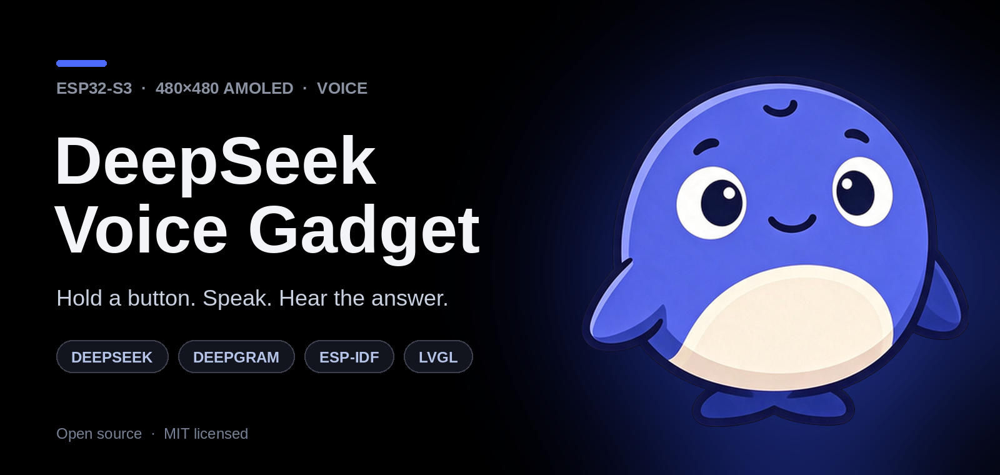

# DeepSeek Voice Gadget



A small, purpose-built voice assistant for the **Waveshare ESP32-S3-Touch-AMOLED-2.16**
(ESP32-S3R8, 16 MB flash, 8 MB PSRAM).

Hold the left button, speak, release. The gadget records, transcribes, asks
DeepSeek (or your own local harness), and speaks the answer out loud — with an
animated mascot that reacts to each state.

No agent framework on the MCU, no Lua runtime, no skill system. One firmware
loop and one small host relay.

---

## Features

- **Push-to-talk** — recording starts on press, stops 0.4 s after release.
- **Deepgram** speech-to-text and text-to-speech, with mic gain handled host-side.
- **DeepSeek** answers, directly or through a local `dsh` harness.
- **Animated mascot** with four poses (idle, listening, thinking, speaking).
- **480×480 AMOLED** UI with large, readable reply text.
- **Screen off/on** with the right-hand button.
- **Wi-Fi reconnect** and stale-press dropping so it never queues old answers.

## How it works

```
        ┌──────────────┐   hold BOOT    ┌───────────────────────────────┐
        │  ESP32-S3    │───────────────▶│ record 16 kHz mono PCM (WAV)  │
        │  AMOLED      │                └───────────────┬───────────────┘
        │  gadget      │                                │ HTTP (LAN)
        │              │                                ▼
        │              │                 ┌──────────────────────────────┐
        │              │                 │  relay/stt_relay.py (host)   │
        │              │                 │  • Deepgram STT + mic gain   │
        │              │                 │  • Deepgram TTS              │
        │              │                 │  • host clock                │
        │              │                 │  • optional dsh bridge       │
        │              │                 └──────────────┬───────────────┘
        │              │                                │
        │              │       2. reply text             │
        │              │◀───────────────┐               │
        │              │                │               ▼
        │              │       3. TTS   │      ┌─────────────────────────┐
        └──────────────┘◀───────────────┘      │ DeepSeek API            │
               │                               │ or local dsh harness    │
               ▼                               └─────────────────────────┘
           speaker
```

Why a relay? It keeps the Deepgram key off the device, amplifies the quiet
microphones far better than the codec can, and gives the board a single LAN
endpoint for speech and chat.

## Hardware

| Part | Detail |
| --- | --- |
| Board | Waveshare ESP32-S3-Touch-AMOLED-2.16 |
| MCU | ESP32-S3R8, 240 MHz, 8 MB PSRAM |
| Flash | 16 MB |
| Display | 2.16" 480×480 AMOLED, CO5300, QSPI |
| Audio | ES7210 mic ADC + ES8311 codec + speaker amp |
| Buttons | BOOT (GPIO0), KEY3 (GPIO18), PWR (AXP2101) |
| USB | Native USB-Serial/JTAG (`/dev/ttyACM0`) |

## Repository layout

| Path | What it is |
| --- | --- |
| `firmware/voice/main/main.c` | Entry point, buttons, the voice loop |
| `firmware/voice/main/audio.c` | I2S, ES7210/ES8311, WAV capture, playback |
| `firmware/voice/main/net.c` | DeepSeek/harness chat + relay HTTP |
| `firmware/voice/main/ui.c` | LVGL screen, mascot states, screen power |
| `firmware/voice/main/mascot_*.c` | Generated 240×240 RGB565 mascot assets |
| `firmware/voice/sdkconfig.defaults` | PSRAM, TLS, console, fonts |
| `relay/stt_relay.py` | Host relay: STT, TTS, clock, harness bridge |
| `tools/make_mascot_assets.py` | Sprite sheet → LVGL asset converter |
| `assets/` | Hero art and the mascot sprite sheet |

## Quick start

### 1. Prerequisites

- ESP-IDF **v6.0.1** (`export.sh` available)
- Python 3.10+ for the relay
- A [Deepgram](https://deepgram.com) API key (STT/TTS)
- A DeepSeek API key, or a local `dsh` harness

### 2. Clone and configure

```sh
git clone https://github.com/HMBS/deepseek-voice-gadget.git
cd deepseek-voice-gadget

cp firmware/voice/main/secrets.example.h firmware/voice/main/secrets.h
$EDITOR firmware/voice/main/secrets.h
```

Fill in Wi-Fi (2.4 GHz), the relay URL (your computer's LAN IP), and keys.
`secrets.h` is gitignored — never commit it.

### 3. Run the relay

```sh
export DEEPGRAM_API_KEY=...
export DEEPSEEK_API_KEY=...        # only for the harness bridge
python3 relay/stt_relay.py --port 8799 --gain 12
```

The relay listens on `0.0.0.0:8799`, so the board can reach it over Wi-Fi.

### 4. Build and flash

With ESP-IDF exported and `idf.py` on `PATH`:

```sh
cd firmware/voice
./idf.sh build
./idf.sh -p /dev/ttyACM0 flash monitor
```

`idf.sh` also works if ESP-IDF lives at `firmware/esp-idf`.

### 5. Use it

- **Left button (BOOT):** press and hold while speaking, release to send.
- **Right button (KEY3):** tap to turn the screen off, tap again to turn it on.
- Pressing the talk button also wakes the screen.

## Configuration

All settings are compile-time in `firmware/voice/main/secrets.h`, because the
USB-Serial/JTAG console on this board does not accept input reliably.

| Define | Meaning |
| --- | --- |
| `CFG_WIFI_SSID` / `CFG_WIFI_PASSWORD` | 2.4 GHz network |
| `CFG_RELAY_URL` | e.g. `http://192.168.1.10:8799/` |
| `CFG_DEEPSEEK_KEY` | API key (also passed to the harness bridge) |
| `CFG_DEEPSEEK_MODEL` | e.g. `deepseek-chat` |
| `CFG_DEEPSEEK_URL` | chat endpoint (see below) |
| `CFG_RECORD_MS` | hard cap on recording (default 15 s) |
| `CFG_VOLUME` | codec volume 0–100 |
| `CFG_PLAY_GAIN` | software gain with soft-knee limiter |

### Direct API vs local harness

Point `CFG_DEEPSEEK_URL` at either:

```c
/* Direct */
#define CFG_DEEPSEEK_URL "https://api.deepseek.com/chat/completions"

/* Through the relay's OpenAI-compatible shim, answered by a local dsh harness */
#define CFG_DEEPSEEK_URL "http://192.168.1.10:8799/v1/chat/completions"
```

In harness mode the relay runs `dsh --profile headless --approval-policy never`
once per question. That makes a harness bound to `127.0.0.1:3080` reachable from
the board without exposing it to the LAN. Each question is a fresh headless run,
so it does not share the web session's history.

The relay flags:

```sh
--deepseek-key KEY   # passed to the child harness as DEEPSEEK_API_KEY
--dsh-bin PATH       # default: newest ~/.npm/_npx/*/node_modules/.bin/dsh
--dsh-cwd PATH       # working directory for the harness
--dsh-timeout SEC    # default 50
```

### Volume

```c
#define CFG_VOLUME     80     /* codec curve: 100 = 0 dB, 90 = -5 dB */
#define CFG_PLAY_GAIN  3.0f   /* soft-knee limited, above ~3.5x sounds squashed */
```

Deepgram TTS peaks around 48% of digital full scale; the playback path applies
gain with a soft knee above 26 000 so quiet speech is boosted without hard
clipping.

## The mascot

A DeepSeek-blue whale reacts to each state:

| State | Pose |
| --- | --- |
| Ready | smiling, looking ahead |
| Listening | fin cupped to its ear |
| Transcribing / Thinking | fin on chin, thought dots |
| Speaking | open mouth, sound waves |
| Error | thinking pose, red accent bar |


Art is a 2×2 sprite sheet on pure black, converted to raw 240×240 RGB565 arrays
(no alpha) so the corners blend into the OLED background. Regenerate after
replacing the sheet:

```sh
python3 tools/make_mascot_assets.py assets/mascot_sheet.png firmware/voice/main
```

## Hard-won implementation notes

These cost real debugging time; they are worth knowing if you fork this:

- **`esp_codec_dev_read()` / `write()` return a status code, not a byte count.**
  Zero means success. Treating the return as a length silently discards every
  recorded sample.
- **`esp_http_client_perform()` discards the response body** unless an event
  handler is installed. The firmware drives `open` → `write` → `fetch_headers` →
  `read` manually.
- **TLS needs PSRAM.** Internal RAM is too tight for mbedTLS working buffers, so
  `CONFIG_MBEDTLS_EXTERNAL_MEM_ALLOC=y`; the DeepSeek call runs on a 16 KB stack.
- **Never apply gain to a WAV file as a whole** — it corrupts the RIFF header and
  Deepgram rejects it as "corrupt or unsupported data". Gain the PCM, rebuild the
  header.
- **Watch the I2S DMA.** Streaming TTS from Deepgram arrives slower than
  real-time on Wi-Fi, so the speaker stutters; buffer the full clip instead.
- **Disable Wi-Fi modem sleep** (`WIFI_PS_NONE`). RTT dropped from ~300 ms to
  ~40 ms and throughput improved substantially.
- **LVGL band height must divide the screen.** A 50-line draw buffer leaves a
  30-line final band and a visible dark row; 48 works.
- **Mic level is low.** Speech RMS ~10–250; the relay applies `--gain` (12 is a
  good starting point) with peak limiting.

## Security

- `firmware/voice/main/secrets.h` is gitignored and contains Wi-Fi credentials
  and API keys. Use `secrets.example.h` as the template.
- The relay holds the Deepgram key; the board only needs it for STT/TTS requests
  proxied through the relay.
- Harness mode runs an agent with `--approval-policy never` on every spoken
  question. Risky tool calls are denied, but read-only tools may inspect the
  `--dsh-cwd` directory. Point it at a scratch directory if that matters.
- Rotate any key that has ever been pasted into a chat, log, or screenshot.

## License

MIT — see [LICENSE](LICENSE).
